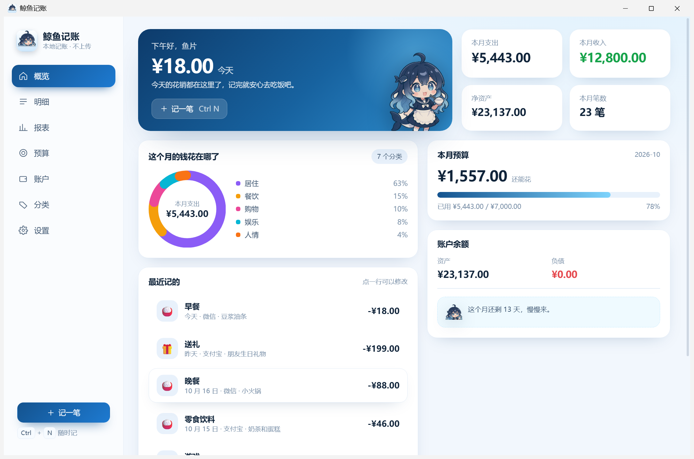
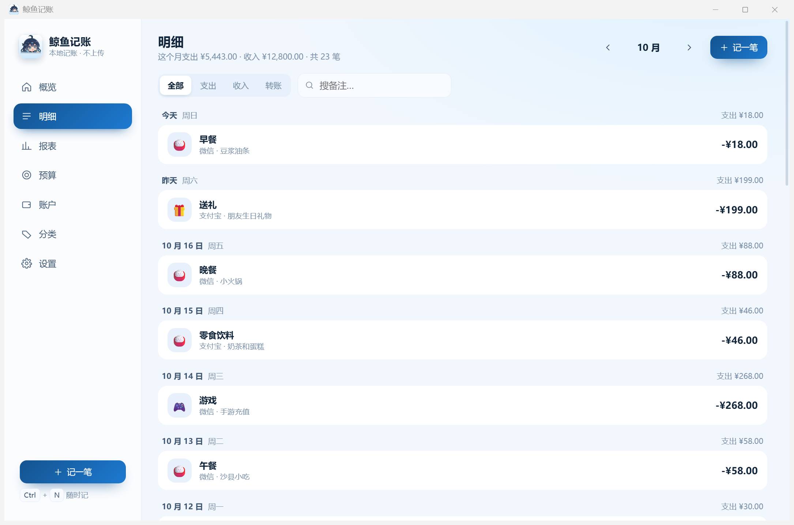
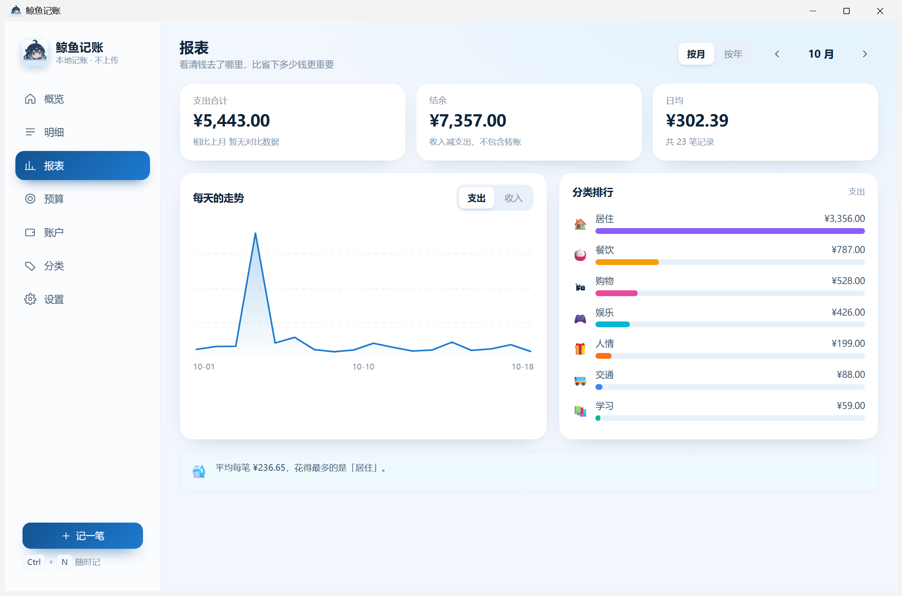
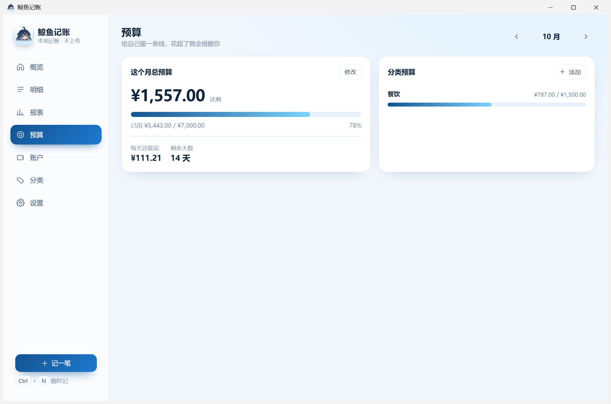
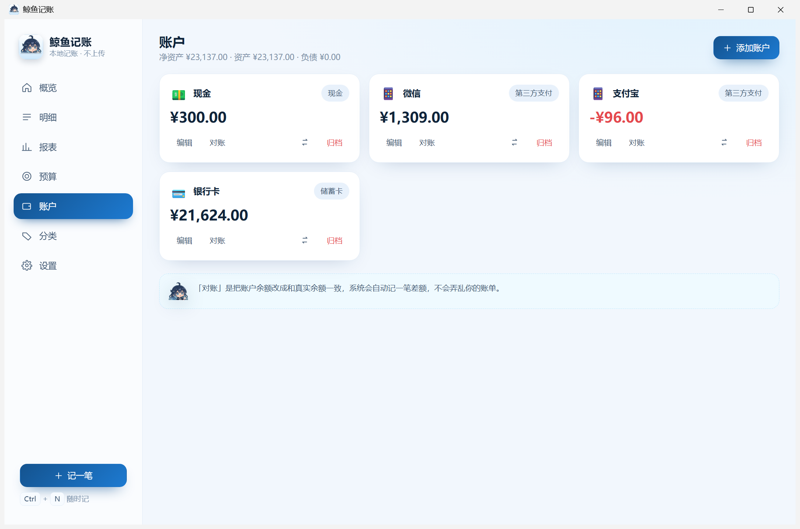

# 鲸鱼记账 · Whale Ledger

> 只存在你电脑里的 Windows 记账本。不注册、不联网、不上传，配一只会催你记账的鲸鱼娘。

一个面向 Windows 11 的本地优先记账软件。数据全部保存在本机的一个 SQLite 文件里，
断网也能正常使用；键盘优先，从唤起录入到保存都可不开鼠标完成。



## 功能

| 模块 | 能力 |
|------|------|
| 记账 | 支出 / 收入 / 转账；金额栏支持 `12.5+8` 这样的算式；`Ctrl+N` 随时唤起 |
| 分类 | 两级分类，可增改、换图标；删除为归档，历史记录不丢 |
| 账户 | 现金、储蓄卡、信用卡、第三方支付、投资、借款；支持对账（自动生成差额调整） |
| 预算 | 月度总预算 + 分类预算，超支变色提示 |
| 报表 | 分类占比环形图、每日支出趋势、按月/按年切换、分类排行 |
| 导入 | 支付宝 / 微信 / 银行 CSV，按日期+金额+备注去重，重复导入不会重复记账 |
| 导出 | CSV（带 BOM，Excel 打开不乱码） |
| 备份 | 一键备份数据库，可在设置里查看历史备份 |

### 界面

| 明细 | 报表 |
|------|------|
|  |  |

| 预算 | 账户 |
|------|------|
|  |  |

## 下载与安装

在 [`dist-release/`](dist-release/) 目录里：

- **`鲸鱼记账-1.0.0-安装版.exe`** —— 双击安装，装完桌面会有快捷方式（推荐）
- **`鲸鱼记账-1.0.0-绿色版.zip`** —— 解压即用，删文件夹就是卸载
- **`使用说明.html`** —— 图文版小白说明，双击用浏览器打开

> 安装时如果弹出「Windows 已保护你的电脑」，点「更多信息」→「仍要运行」。
> 这是因为安装包没有购买代码签名证书，不是病毒。

### 第一次使用

1. 打开软件，按 `Ctrl + N`
2. 选支出 / 收入 / 转账，填金额，选分类，回车保存
3. 想改哪笔就点哪一行；删除后账户余额会自动还原

### 快捷键

| 按键 | 作用 |
|------|------|
| `Ctrl + N` | 记一笔 |
| `Ctrl + F` | 搜索明细 |
| `Ctrl + 1..6` | 切换页面 |
| `Enter` | 保存当前表单 |
| `Esc` | 关闭弹窗 |

### 数据在哪

```
%APPDATA%\com.whaleledger.app\whale.db
```

单文件 SQLite，复制走即完成迁移。设置页的「立即备份」会在同目录 `backups/` 下留一份带时间戳的副本。
程序没有任何联网代码，断网可正常使用。

## 技术栈

- **Electron 44**（Chromium 内核）+ **React 19** + **TypeScript**
- **sql.js**（SQLite 编译为 WebAssembly），数据层跑在主进程，渲染进程通过 IPC 调用
- 打包：NSIS（LZMA 固实压缩），安装到 `%LOCALAPPDATA%`

选型上有一处偏离：设计文档最初选的是 Tauri 2，但它在个别 Windows 11 预览版机器上
WebView2 渲染进程起不来（详见 [开发日志](docs/开发日志.md)）。改用 Electron 自带内核后稳定，
代价是安装包从 ~15 MB 变成 ~100 MB（内置浏览器内核的固有体积）。

架构层面的设计文档见 [`docs/鲸鱼记账-需求分析与技术方案设计文档.docx`](docs/鲸鱼记账-需求分析与技术方案设计文档.docx)。

## 本地开发

```bash
cd app
pnpm install
pnpm build          # 类型检查 + 构建前端到 app/dist
pnpm start          # 启动 Electron（加载 app/dist）
```

调试时可用环境变量覆盖数据目录，避免污染真实账本：

```bash
WHALE_DATA="D:\\tmp\\whale-dev" pnpm start
```

重新生成吉祥物素材（需要 Python + Pillow）：

```bash
cd app
pnpm assets         # 抠图、裁头像、生成 icon-source.png
pnpm icons          # 生成各尺寸图标
```

打包 Windows 安装程序需要 NSIS：

```bash
makensis installer.nsi
```

## 目录结构

```
app/
  electron/        主进程：窗口、IPC、数据库（sql.js）
  src/             渲染进程：React 页面与组件
  src/assets/      鲸鱼娘素材（立绘 / 头像 / Logo）
  icon-source.png  应用图标源图
docs/              需求与技术方案、使用说明、开发日志、截图
dist-release/      发布产物（安装包 / 绿色版 / 说明）
installer.nsi      NSIS 安装脚本
release/           免安装目录（构建产物，不入库）
```

## 记账规则（实现细节）

有几条容易做错的地方，这里是明确的约定：

1. **转账不计入收支**。转账是单条记录 + 双账户引用，两个账户余额一增一减，报表里不出现。
2. **信用卡余额为负**。欠款以负数表达，净资产 = 资产合计 + 负债合计。
3. **余额是派生数据**。账户余额由初始余额 + 流水推导，缓存与重算冲突时以重算为准。
4. **金额以「分」为单位的整数存储**，不做浮点运算。
5. **日期用不带时区的 `YYYY-MM-DD`**，避免跨时区导致月份漂移。

## 许可

MIT
